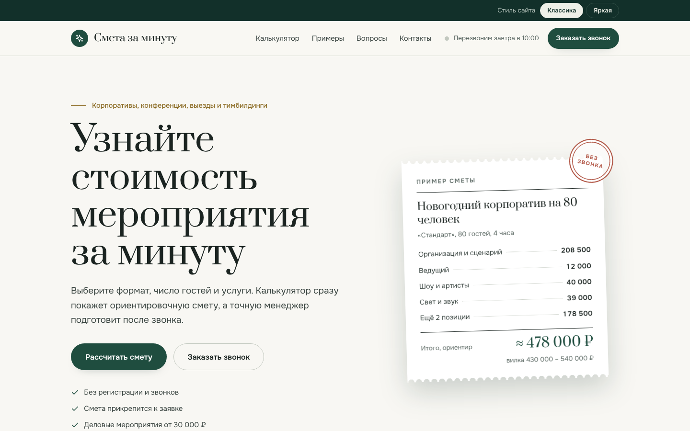
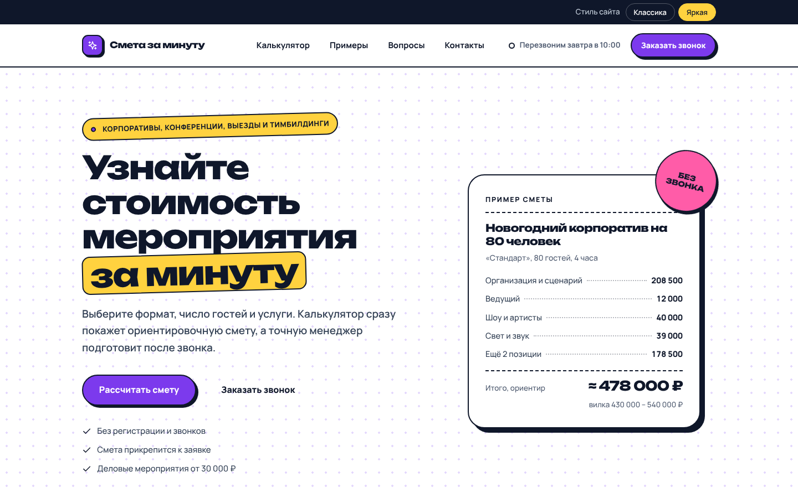
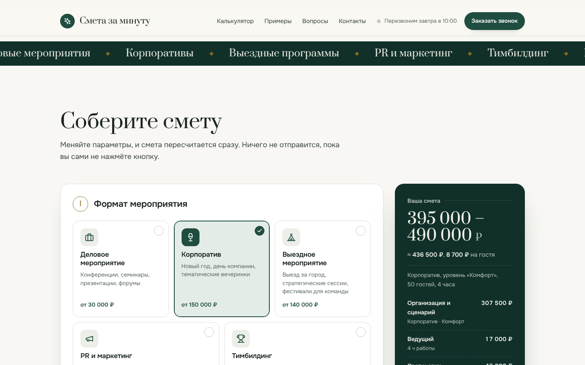
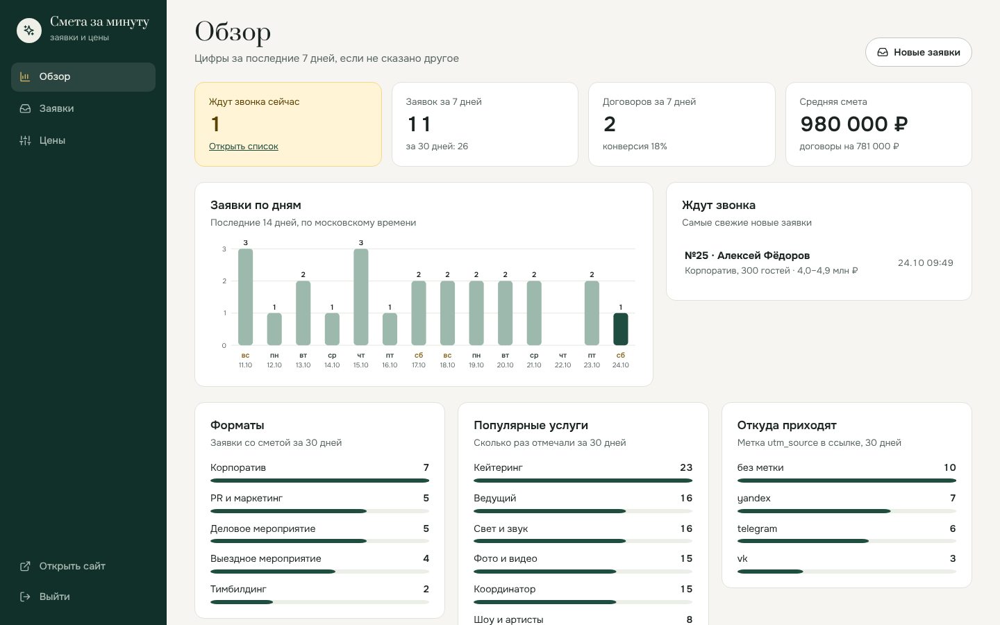
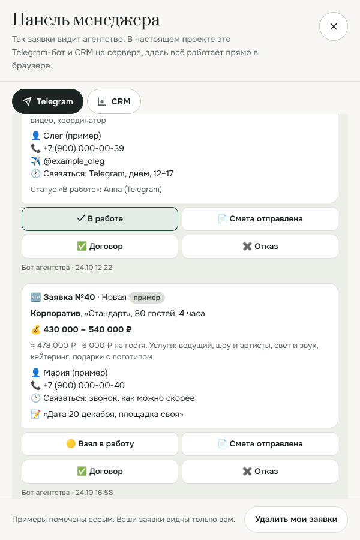
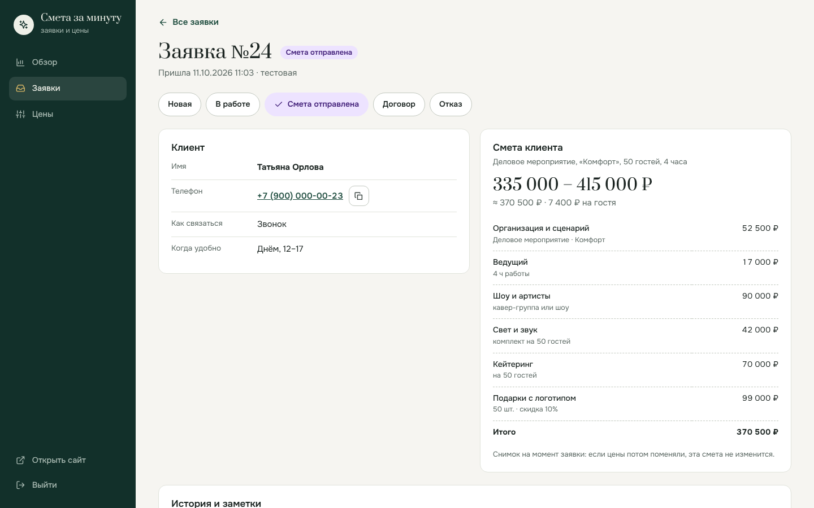
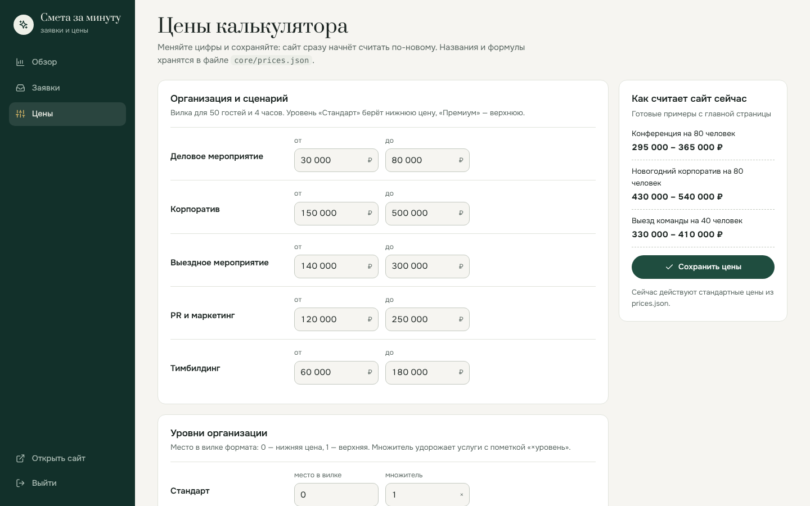
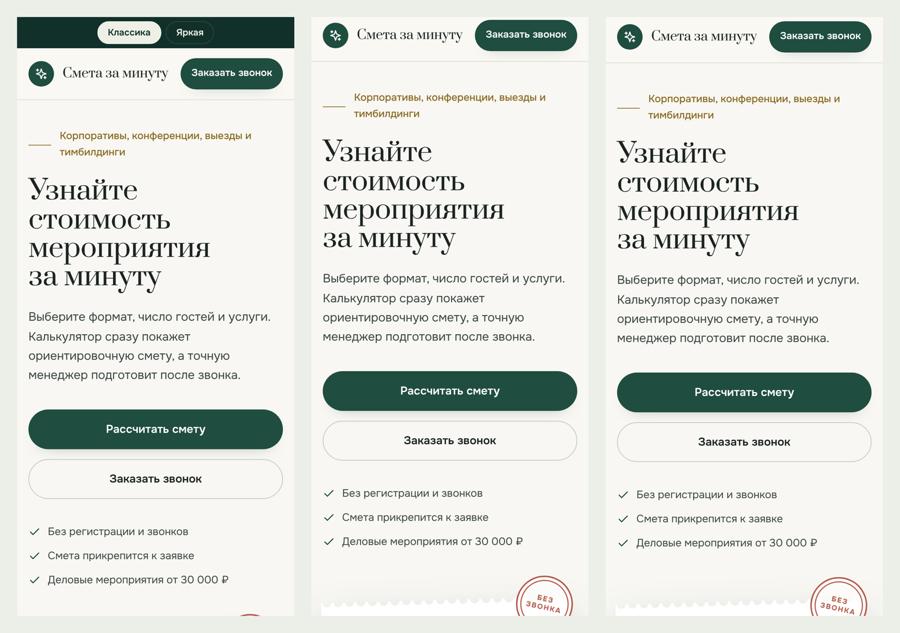
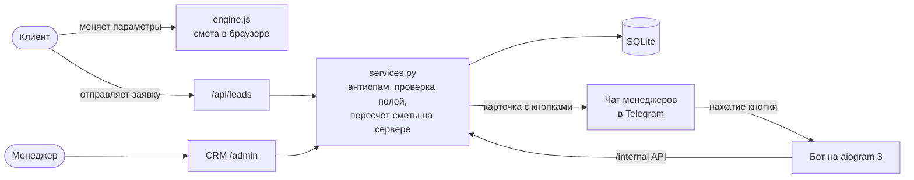

# Смета за минуту

Сайт агентства мероприятий, на котором клиент сам считает примерную стоимость корпоратива, конференции или выезда и оставляет заявку. Заявка вместе со сметой сразу приходит менеджерам в Telegram, а статусы и цены ведутся в небольшой CRM.

[](https://github.com/kot2015311/event-smeta/actions/workflows/ci.yml)


**Демо без установки:** https://kot2015311.github.io/event-smeta/ — калькулятор, форма заявки и «панель менеджера», которая показывает, как заявку видит агентство.



## Задача

Агентство отвечает на одни и те же вопросы по телефону: «сколько стоит корпоратив на 80 человек?». Менеджер тратит время на звонок, а клиент ждёт ответа и уходит к конкурентам. Онлайн-калькулятор есть у немногих агентств, обычно предлагают только созвон.

Нужно было:

- дать клиенту примерную цену за минуту, без звонка и регистрации;
- принимать заявку сразу с расчётом, чтобы менеджер не переспрашивал детали;
- сообщать о заявке мгновенно и подсказывать, когда перезвонить: агентство работает по будням с 8 до 17 и по выходным с 10 до 15;
- дать менеджеру возможность менять цены без программиста.

## Что получилось

**Сайт для клиента**
- Калькулятор в четыре шага: формат, гости и длительность, уровень организации, 12 дополнительных услуг. Смета пересчитывается при каждом изменении и остаётся на виду справа.
- Готовые примеры («Новогодний корпоратив на 80 человек»), которые открываются в калькуляторе одним нажатием.
- Ссылка на смету: параметры попадают в адрес страницы, расчётом можно поделиться.
- Форма заявки с маской телефона и проверкой полей. Смета прикрепляется к заявке автоматически.
- Статус «На связи до 17:00» или «Перезвоним завтра в 8:00» по московскому времени.
- Два стиля оформления на одной разметке: «Классика» и «Яркая». Переключаются на лету.
- Работает на телефоне и даже без JavaScript: калькулятор пересчитывается кнопкой, заявка уходит обычной формой.
- SEO: описание, Open Graph для превью ссылки, разметка schema.org (организация, часы работы, FAQ), sitemap.xml и robots.txt.

**Telegram**
- Карточка новой заявки в чате менеджеров: мероприятие, смета, контакты, комментарий и подсказка, когда звонить.
- Кнопки «Взял в работу», «Смета отправлена», «Договор», «Отказ». Нажатие меняет статус в CRM, а карточка обновляется у всех.
- Команды бота: `/new`, `/open`, `/today`, `/week`, `/lead 12`.

**CRM для менеджера** (`/admin`)
- Обзор: кто ждёт звонка, заявки по дням, конверсия, средняя смета, популярные форматы, услуги и источники рекламы.
- Список заявок с фильтром по статусу и формату, поиском по имени, телефону и номеру и выгрузкой в Excel (CSV).
- Карточка заявки: контакты, снимок сметы на момент заявки, смена статуса, заметки и история действий.
- Редактор цен: менеджер правит цифры, сайт сразу считает по-новому, изменённые поля подсвечены.

| Стиль «Яркая» | Калькулятор |
| :---: | :---: |
|  |  |

| CRM: обзор | Карточка в Telegram |
| :---: | :---: |
|  |  |

| Заявка в CRM | Редактор цен |
| :---: | :---: |
|  |  |



## Как это устроено



Главные решения:

1. **Цены отдельно от кода.** Все цены и правила лежат в [`core/prices.json`](core/prices.json). Формула одна, но написана дважды: на Python ([`core/pricing.py`](core/pricing.py)) и на JavaScript ([`engine.js`](app/static/js/engine.js)). В браузере цена меняется мгновенно, а сервер пересчитывает смету сам, поэтому подделать её из браузера нельзя.
2. **Две реализации сверяются тестом.** Формулу я перенёс из первого макета сайта. Скрипт [`scripts/golden`](scripts/golden) прогнал старый калькулятор на 401 наборе параметров и сохранил ответы в [`golden_estimates.json`](tests/golden_estimates.json). Тесты проверяют, что и Python, и JS выдают те же суммы и подписи до рубля.
3. **Бот не трогает базу.** Он работает через служебный API сайта с секретным токеном. Данные живут в одном месте, а бота можно запустить на другом сервере.
4. **Простой стек.** Встроенный SQLite и обычный SQL в одном файле [`app/repo.py`](app/repo.py): каждый запрос видно, и при росте их легко перенести на PostgreSQL.

Безопасность: CSRF-токены в формах CRM, Content-Security-Policy, ограничение частоты заявок и попыток входа, ловушка для спам-ботов, сравнение пароля за постоянное время, экранирование всего, что ввёл клиент, перед отправкой в Telegram.

## Стек

Python 3.11+, Flask 3, SQLite, aiogram 3, requests, чистый JavaScript без фреймворков, HTML и CSS с двумя темами на CSS-переменных, pytest, ruff, Docker и docker compose, GitHub Actions (тесты и публикация демо на GitHub Pages).

## Запуск у себя

Нужен Python 3.11 или новее.

```bash
git clone https://github.com/kot2015311/event-smeta.git
cd event-smeta
python -m venv .venv
# Windows:      .venv\Scripts\activate
# macOS, Linux: source .venv/bin/activate
pip install -r requirements-dev.txt
cp .env.example .env          # в Windows: copy .env.example .env
```

Откройте `.env` и впишите хотя бы `ADMIN_PASSWORD`. Затем:

```bash
flask seed-demo   # 24 тестовые заявки, чтобы в CRM было что посмотреть
flask run
```

Сайт откроется на http://127.0.0.1:5000, CRM — на http://127.0.0.1:5000/admin. Удалить тестовые заявки: `flask clear-samples`.

### Подключить Telegram

1. Создайте бота у [@BotFather](https://t.me/BotFather) командой `/newbot` и вставьте токен в `TELEGRAM_BOT_TOKEN`.
2. Создайте группу для менеджеров и добавьте в неё бота. Напишите в группе любое сообщение.
3. Откройте `https://api.telegram.org/bot<ТОКЕН>/getUpdates` и найдите `"chat":{"id":-100…}`. Это `TELEGRAM_CHAT_ID`.
4. Придумайте секрет для связи сайта и бота: `python -c "import secrets; print(secrets.token_urlsafe(32))"` и вставьте в `INTERNAL_API_TOKEN`.
5. Проверьте связь: `flask telegram-test`. В группе появится сообщение.
6. Во втором терминале запустите бота: `python -m bot`.

### Через Docker

```bash
docker compose up -d --build
```

Поднимутся два контейнера: сайт на порту 8000 и бот. База хранится в томе `smeta-data` и переживает пересборку. Для настоящего домена поставьте перед сайтом nginx с HTTPS, укажите `SITE_URL=https://ваш-домен` и `TRUST_PROXY=1`.

### Демо-версия

`flask build-demo` собирает одну HTML-страницу без сервера в `dist/demo`. При push в `main` её публикует GitHub Actions. Один раз включите в репозитории: Settings → Pages → Source: GitHub Actions.

## Тесты

```bash
pytest                            # 504 теста, около 3 секунд
node scripts/check_js_engine.mjs  # сверка JS-движка с эталоном (pytest запускает её сам, если есть Node.js)
ruff check . && ruff format --check .
```

Тесты покрывают расчёт сметы, проверку заявок, антиспам, API, CRM (вход, статусы, заметки, выгрузку, цены), карточки Telegram, служебный API и клиент бота против настоящего сайта.

## Структура

```text
core/                 логика без веба, общая для сайта и бота
  prices.json         цены, форматы, услуги, график работы
  pricing.py          расчёт сметы
  leads.py            проверка заявки
  cards.py            тексты и кнопки для Telegram
  schedule.py         открыто ли сейчас и когда перезвоним
app/                  сайт на Flask
  views/site.py       главная, форма без JS, sitemap
  views/api.py        API для калькулятора и заявок
  views/admin.py      CRM
  views/internal.py   служебный API для бота
  services.py         приём заявки и смена статуса
  repo.py             все SQL-запросы
  notify.py           отправка карточек в Telegram
  templates/, static/ шаблоны, стили, engine.js и site.js
bot/                  Telegram-бот на aiogram 3
tests/                pytest и эталонные сметы
scripts/              сверка JS-движка, генератор эталона
docs/                 скриншоты и разбор проекта
```

Подробный разбор с примером расчёта и ответами на вопросы заказчика: [docs/kak-ustroeno.md](docs/kak-ustroeno.md).

## Что можно добавить

- PDF со сметой, который клиент скачивает или получает на почту.
- Учётные записи для нескольких менеджеров вместо общего пароля.
- Передачу заявок в amoCRM или Битрикс24.
- PostgreSQL вместо SQLite для большой нагрузки.

Цены в калькуляторе ориентировочные: часть собрана по открытым прайсам агентств, часть оценена.

## Автор

Артём Ильин, [github.com/kot2015311](https://github.com/kot2015311). Лицензия MIT.
